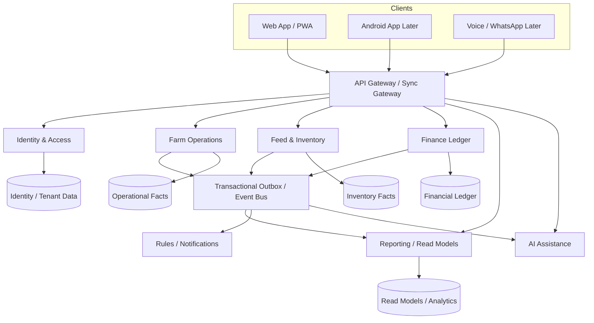

# Poultry Intelligence
## Advanced End-to-End Broiler Farm Operating System
### Product Blueprint, System Architecture, Data Model, Security, Offline Sync, and Technology Stack

**Version:** 1.1 — Validated Architecture Baseline / Implementation Draft  
**Revision:** 2026-10-12  
**Deployment authority:** Architecture baseline only; no production migration approval  
**Product:** Poultry Intelligence  
**Primary market:** Independent broiler farmers, India-first and globally adaptable  
**Product type:** End-to-end farm operations, business-control, traceability, and decision-support platform  
**AI position:** Supporting capability; never the source of truth for farm facts  

---

# Table of Contents

1. Executive Summary
2. Product Vision and Operating Principles
3. Users, Roles, and Access Model
4. End-to-End Farmer Journey
5. Product Modules and Page Architecture
6. Information Architecture and Navigation
7. Domain Model and Source-of-Truth Rules
8. Core Calculations and Reconciliation Rules
9. Indian Field Operations and Commercial Realities
10. AI Assistance Architecture and Safety Boundaries
11. System Architecture
12. Data Architecture and Database Design
13. Offline-First Synchronization Architecture
14. Security, Authorization, and Audit Architecture
15. API and Event Architecture
16. Reporting, Analytics, and Data Quality
17. External Integrations and Data Governance
18. Technology Stack
19. Environments, Deployment, CI/CD, and Operations
20. Scalability and Reliability Strategy
21. Testing and Quality Strategy
22. Product Roadmap
23. Explicit Non-Goals
24. Success Metrics
25. Architecture Decision Checklist
26. Engineering Validation and Reference Implementation Standards
27. Bounded Implementation Milestones
28. System Status and Database Deployment Authority

---

# 1. Executive Summary

Poultry Intelligence is an end-to-end operating system for independent broiler farms. It enables farmers, managers, workers, consultants, and future integrator organizations to manage every batch from chick receiving through dispatch and commercial closeout.

The platform combines:

```text
Farm and shed management
Batch lifecycle management
Daily farm records
Mortality and live-bird reconciliation
Feed, water, inventory, and input traceability
Weight, growth, and feed-efficiency analysis
Health, vaccination, biosecurity, and maintenance records
Tasks, worker accountability, and SOPs
Dispatch, settlement, buyer/supplier records
Finance, credit/udhar, payables, receivables, and batch economics
Reports, exports, traceability, audit history, and data-quality disclosure
Offline-first synchronization
AI-assisted capture, explanation, summaries, and future forecasting
```

The system is not an AI chatbot, a veterinary diagnosis tool, a generic ERP, or an accounting application with a poultry skin. It is a farmer-first operational platform where the farm record is the source of truth.

## 1.1 Core product promise

```text
Record daily work quickly.
Understand the full batch clearly.
Act on evidence.
Correct mistakes safely.
Review business and operational results.
Prepare the next batch with lessons from the last one.
```

## 1.2 Strategic principle

> **Facts are recorded once, preserved with correction history, and used to derive every dashboard, report, alert, finance result, and AI explanation.**

---

# 2. Product Vision and Operating Principles

## 2.1 Vision

> **Poultry Intelligence gives every independent broiler farmer one trusted operating system for flock, feed, water, health, biosecurity, inventory, team work, finance, dispatch, and reports.**

## 2.2 Questions the product must answer quickly

```text
How many birds are alive?
What happened today?
What needs attention now?
How much feed is available and being used?
Are birds gaining weight as expected?
Are water, shed conditions, or equipment affecting operations?
What is due to suppliers and from buyers?
What is the recorded cost and estimated business position of this batch?
Can I trust these numbers?
What must be prepared before the next batch?
```

## 2.3 Non-negotiable principles

```text
1. Missing data is never interpreted as zero.
2. Explicit zero must remain distinct from not recorded.
3. Operational facts are append-only where practical.
4. Corrections preserve the original fact, actor, timestamp, and reason.
5. Derived metrics are not editable facts.
6. Farm data is isolated by organization, farm, shed, and batch.
7. Offline data entry is first-class.
8. Sync retries must not create duplicate events.
9. Worker access is restricted in UI, API, and database layers.
10. Reports disclose missing, partial, estimated, and recorded data.
11. AI explains evidence and does not silently write farm facts.
12. Financial and commercial settlements are explicit ledgers, not hidden net balances.
```

---

# 3. Users, Roles, and Access Model

## 3.1 Primary users

| Role | Main job | Main screens | Financial visibility |
|---|---|---|---|
| Owner | Manage farm health, business performance, risk, and strategy | Today, Batches, Business, Reports | Full |
| Farm manager | Coordinate daily work, tasks, and shed operations | Today, Farm Work, Alerts, Tasks | Configurable |
| Shed worker | Record assigned daily operations | Daily Round, Tasks, Mortality, Feed, Water | None |
| Veterinarian/consultant | Review factual flock and health history | Batch Detail, Health Timeline, Conditions | Consent-based, no finance by default |
| Integrator/supervisor | Review assigned farm portfolio | Portfolio, Exceptions, Batch Comparison | Aggregated/consented only |
| Accountant, later | Reconcile invoices, payments, and exports | Finance, Reports, Suppliers, Buyers | Finance only |

## 3.2 Role enforcement model

Authorization is enforced in three layers:

```text
1. Presentation layer
   UI does not display restricted pages, values, or actions.

2. Application/API layer
   Every request validates identity, organization, farm, shed, role, assignment,
   payload schema, and business rule.

3. Database layer
   Row-Level Security and tenant policies restrict direct user-scoped access.
```

## 3.3 Worker offboarding

When a worker leaves:

```text
Account status → inactive
Sessions and refresh tokens → revoked
Farm/shed assignment → removed
Open tasks → reassigned or reviewed
Historic facts → retained with original actor attribution
Access-status change → audit event created
```

Do not delete a worker identity that is referenced by operational history.

---

# 4. End-to-End Farmer Journey

## 4.1 Batch lifecycle

```text
Farm setup
→ Shed readiness
→ Chick receiving
→ Placement
→ First 24-hour check
→ Active grow-out
→ Daily operations
→ Weekly performance review
→ Harvest/dispatch
→ Sale and settlement
→ Batch closeout
→ Cleanout/downtime
→ Next batch readiness
```

## 4.2 Lifecycle journey table

| Moment | Farmer action | System behavior | Primary records |
|---|---|---|---|
| Pre-placement | Check shed, water, feed, litter, equipment | Readiness checklist and open-task list | Readiness, maintenance, inventory |
| Chick arrival | Receive and count chicks | Placement reconciliation and supplier/lot traceability | Placement record |
| First day | Confirm water, feed, brooding, litter, distribution | First-day completion and concern status | First 24-hour check |
| Daily round | Record mortality, feed, water, observations | Update local dashboard and record completeness | Daily Farm Round |
| Issue observed | Log leak, wet litter, abnormal behavior, equipment issue | Create task/alert with evidence | Observation/task/maintenance |
| Weekly review | Weigh sample birds | Update trend and data-quality status | Weight sample |
| Feed receipt/use | Receive, issue, count, waste feed | Update inventory and runway | Feed movement/inventory lot |
| Health/biosecurity | Record observation, vaccination, visitor, cleaning | Build factual timeline and due list | Health/biosecurity records |
| Dispatch | Catch, load, and reconcile birds | Update dispatch balance and closeout readiness | Dispatch record |
| Settlement | Record buyer weight, deductions, receipt/payment | Update commercial reconciliation | Sale/settlement/receipt |
| Closeout | Review record gaps, economics, lessons | Produce report and next-batch plan | Closeout/report/lessons |

---

# 5. Product Modules and Page Architecture

The product should have roughly **18–24 core pages at launch** and grow to around **22–28 routes** without exposing all of them as flat navigation.

## 5.1 Today dashboard

**Purpose:** Answer “What should I do now?”

### Required content

```text
Active farm and batch context
Batch day and expected harvest context
Live birds
Today mortality
Feed runway
Daily Farm Round completion
Top 1–3 action items
My due tasks
Quick record actions
Record completeness
Latest weight and FCR status
Owner-only business summary
Recent activity
```

### Design hierarchy

```text
Top: active batch, live birds, daily round state
Middle: most urgent action, feed runway, mortality, weight/FCR
Lower: tasks, evidence-backed insights, compact trends, activity
```

### Exclusions

```text
No full ledger
No dense raw table
No 20 KPI cards
No all-history alert list
No long form
No decorative analytics
```

## 5.2 Daily Farm Round

**Purpose:** Complete normal daily records in 30–90 seconds.

### Fields

```text
Date
Farm, batch, shed
Mortality
Culls
Feed used
Water used
Flock observation
Shed condition
Optional health observation
Optional daily note
Worker/shift sign-off later
Local/sync status
```

### Rules

```text
Explicit zero differs from Not recorded.
Default to active batch and current date.
Use large numeric controls and quick actions.
Show missing required items before save.
Allow save as draft when information is incomplete.
Allow correction through a correction event, not destructive overwrite.
```

## 5.3 Alerts and tasks

**Purpose:** Convert risk into a clear action.

### Content

```text
Severity filters: urgent, attention, due, information
What changed
Why it matters
Evidence
Data coverage
Recommended low-risk next action
Assignee
Status: open, acknowledged, resolved
Resolution note
```

## 5.4 Mortality and bird movements

**Purpose:** Record loss and keep bird balance correct.

### Content

```text
Quick entry
Mortality history
Daily trend
Optional cause/category
Culls
Transfers in/out
Correction history
Live-bird impact
Related health/environment observations
Date ranges: 7 days, 14 days, full batch
```

## 5.5 Feed and inventory

**Purpose:** Prevent stock-outs and distinguish consumption from loss.

### Sections

```text
Feed stock
Feed movements
Feed usage
Feed lots
Physical stock count
Feed loss/wastage
Purchase plans
Supplier history later
```

### Core content

```text
Current stock
Recent daily usage
Days remaining
Expected stock-out
Feed issued by batch/shed
Physical count
Discrepancy status
Suggested purchase quantity
Lot/expiry data when available
```

## 5.6 Water and environment

**Purpose:** Record operational context for flock performance.

### Content

```text
Water consumption
Water source
Supply status
Waterline status
Tank/line cleaning
Leak records
Temperature
Humidity
Litter status
Ventilation status
Environmental observations
```

## 5.7 Weight and performance

**Purpose:** Track growth and feed efficiency.

### Content

```text
Weight sample form
Sample size
Sampling zones
Sampling method
Scale type
Average weight
Weight trend
Previous-sample comparison
Estimated FCR
Feed-use context
Optional selected reference curve
Record coverage
Sample quality
```

## 5.8 Health and vaccination

**Purpose:** Keep factual health history and scheduled interventions.

### Content

```text
Health observations
Affected batch/shed
User-entered factual signs/notes
Vet referral/contact note
Vaccination schedule
Vaccination record
Vaccine lot
Administrator
Date/dose/route where applicable
Upcoming/due schedule
```

## 5.9 Biosecurity

**Purpose:** Keep preventive work visible and traceable.

### Content

```text
Daily checklist
Visitor/vehicle log
PPE/footwear checks
Cleaning/disinfection
Mortality removal record
Pest-control checks
Waterline/litter check
Entry history
Shed-condition history
```

## 5.10 Maintenance and assets

**Purpose:** Prevent equipment failures from becoming flock problems.

### Content

```text
Asset register
Asset type/location/shed
Condition
Service history
Next service date
Open issues
Maintenance tasks
Assignee
Completion notes
Downtime
Owner-only cost later
```

## 5.11 Batches and batch detail

**Purpose:** Manage flock lifecycle and review a full batch story.

### Batch list

```text
Active batches
Farm/shed
Batch day
Live birds
Status
Record completeness
Feed runway
Top issue
Placement/harvest state
```

### Batch detail tabs

```text
Overview
Daily records
Performance
Feed & water
Health & biosecurity
Field operations
Dispatch
Finance
Timeline
Report
```

## 5.12 Placement and first 24-hour check

**Placement fields:**

```text
Placement date/time
Hatchery/chick supplier
Supplier lot/batch reference
Breed/strain
Birds ordered
Birds received
Birds placed
Shortage/excess reconciliation
Optional hatch date/chick age
Vehicle arrival
Delivery reference
Receiving worker
Factual chick-quality observation
```

**First-day fields:**

```text
Feed available
Water available
Brooding/environment check
Litter condition
Distribution check
Drinker/waterline access
Initial mortality
General observation
Completed / concern recorded / not recorded
```

## 5.13 Harvest, dispatch, and settlement

**Dispatch fields:**

```text
Catch time
Birds caught
Birds loaded
Rejected/left behind
Transporter
Vehicle
Destination
Buyer linkage later
Farm-gate weight
Dispatch reference
Pre-dispatch live birds
Post-dispatch live birds
Discrepancy note
```

**Settlement fields:**

```text
Buyer settlement weight
Difference in kg and percentage
Classification: unclassified, transport shrinkage, scale difference, rejection,
buyer deduction, disputed, other
Rejected birds/weight
Transport deduction
Commission deduction
Other deductions
Settlement reference/slip
Settlement date
Review/dispute status
```

## 5.14 Finance and business control

**Purpose:** Give owners credible commercial visibility.

### Sections

```text
Expenses
Supplier invoices
Supplier payments
Sales
Buyer receipts
Payables
Receivables
Cash position
Batch economics
Contra-settlements
```

### Core metrics

```text
Recorded cost
Paid cost
Supplier due
Sales value
Cash received
Buyer due
Cost per bird
Cost per kg
Break-even estimate
Estimated net result
Finance data completeness
```

## 5.15 Suppliers, buyers, purchase plans

```text
Supplier profile: contacts, products, invoices, credit terms, delivery history
Buyer profile: contacts, sales history, dispatch links, receipts, balances
Purchase plan: need source, suggested quantity, supplier, expected delivery, status
```

## 5.16 Reports and exports

```text
Daily summary
Weekly batch summary
Batch closeout report
Feed inventory report
Health/biosecurity report
Dispatch reconciliation
Finance report
Lender-ready operational record summary
CSV export
PDF export
```

Every report includes:

```text
Generated time
Farm/batch scope
Data coverage
Missing-record notice
Calculation definitions
Relevant correction/audit context
```

## 5.17 Team, tasks, and SOPs

```text
Roles
Farm/shed assignments
Tasks
Shift handover
SOP library
Training acknowledgement
Incident notes
```

## 5.18 Settings and data control

```text
Farm profile
Country/region
Locale/unit/date preference
Notification preferences
Data export
Sync status
Connected devices
Consent controls
User management
Security/session controls
Demo mode separate from production
```

---

# 6. Information Architecture and Navigation

## 6.1 Primary groups

```text
Today
Farm work
Batches
Business
More
```

| Group | Content |
|---|---|
| Today | Dashboard, Daily Farm Round, Alerts, My Tasks |
| Farm work | Mortality, Feed & Inventory, Water & Environment, Weight & Performance, Health & Vaccination, Biosecurity, Maintenance |
| Batches | Active Batches, Placement, Dispatch, Closeout, Batch Detail, Comparison |
| Business | Finance, Sales, Suppliers, Buyers, Purchase Plans, Reports |
| More | Farm & Sheds, Team, SOPs, Data Export, Settings, Help |

## 6.2 Mobile navigation

```text
Today
Record
Batches
Tasks
More
```

---

# 7. Domain Model and Source-of-Truth Rules

## 7.1 Core source-of-truth entities

```text
Organization
Profile / User
OrganizationMembership
Farm
Shed
ShedAssignment
Batch
BatchShedAllocation
InventoryLocation
InventoryFinancialLedger
ServerSyncOperationLedger
ClientOutboxOperation
PlacementRecord
FirstDayCheck
DailyFarmRound
MortalityEvent
CullEvent
TransferEvent
FeedMovement
InventoryLot
WaterRecord
WeightSample
HealthObservation
VaccinationEvent
BiosecurityRound
VisitorEntry
ShedConditionObservation
MaintenanceAsset
MaintenanceEvent
Task
DispatchRecord
ExpenseInvoice
SupplierPayment
Sale
BuyerReceipt
ContraSettlement
CorrectionEvent
AuditEvent
SyncOperation
Device
```

## 7.2 Derived entities/projections

```text
LiveBirdBalance
FeedStockBalance
FeedRunway
MortalitySummary
WeightTrend
FCRSummary
RecordCompleteness
BatchStatus
CashPosition
Payables
Receivables
BatchEconomics
ReportProjection
InsightProjection
```

## 7.3 AI artifacts

```text
VoiceTranscript
RecordDraft
AIMessage
AIResponseEvidence
AIFeedback
AIOutcome
ModelRun
SafetyEvent
```

## 7.4 Source-of-truth rule

```text
Confirmed operational facts are source records.
Metrics are deterministic projections.
AI artifacts are separate assistive records.
External sources are labelled external/reference data.
```

---

# 8. Core Calculations and Reconciliation Rules

## 8.1 Live bird balance

```text
Live birds
= placed
+ transfers in
− mortality
− culls
− birds sold
− transfers out
```

Rules:

```text
Do not silently overwrite placed baseline.
Placement receiving discrepancies require review.
Dispatch does not automatically create a sale.
Sale does not automatically reduce birds unless explicitly linked to a bird movement.
Corrections preserve original event history.
```

## 8.2 Feed consumption and inventory

```text
Performance feed consumed
= confirmed feed issued for bird consumption
− confirmed returned feed, where applicable

Inventory reduction
= bird-consumption feed issued
+ spill
+ pest/rodent damage
+ moisture/storage damage
+ expiry/disposal
+ adjustment out
```

FCR uses performance feed consumption, not raw inventory reduction.

## 8.3 Feed runway

```text
Feed runway days
= current recorded stock
÷ recent confirmed average daily feed use
```

Requirements:

```text
Show Unknown when stock or usage is insufficient.
Show data coverage.
Do not create a stock-out date from missing usage data.
Purchase plan does not change stock.
```

## 8.4 Weight and performance

```text
Average weight
= total sampled weight ÷ sample size

Estimated FCR
= confirmed performance feed consumed ÷ selected biomass/weight basis
```

Always display data limitations and sample quality.

## 8.5 Financial ledger rules

```text
Supplier due
= supplier invoice total − approved supplier payments − approved contra settlements

Buyer due
= sale settlement amount − buyer receipts − approved contra settlements

Cash position
= cash received − cash paid

Estimated net result
= recorded revenue − recorded cost
```

All financial values must carry data completeness/estimate context.

---

# 9. Indian Field Operations and Commercial Realities

## 9.1 Offline-first operation under unstable connectivity

Every client mutation is saved locally first.

### Required sync states

```text
Saved locally
Pending sync
Syncing
Synced
Sync issue
Needs review
```

### Operation metadata

```text
Stable operation ID
Idempotency key
Entity type
Entity ID
Action
Occurred time
Client-recorded time
Schema version
Retry count
Last attempt time
Next retry time
Sync status
Failure reason
```

### Adaptive synchronization

```text
Save locally immediately.
Sync when the app opens or returns to the foreground.
Sync when network is usable.
Allow manual Sync now.
Use exponential backoff with jitter.
Stop repeated retries on weak networks.
Preserve pending operations across restart/refresh.
Batch low-priority work where appropriate.
Never mark Synced until server acknowledgment.
```

## 9.2 Feed loss and reconciliation

Supported movement reasons:

```text
Opening balance
Received/purchased
Issued for bird consumption
Returned feed
Transfer in
Transfer out
Spill
Pest/rodent damage
Storage moisture/damage
Expired/disposed
Physical stock adjustment
Unknown discrepancy
```

## 9.3 Weight sample quality

Every sample includes:

```text
Sample size
Shed zones sampled
Sampling method
Recorder
Date/time
Scale type
Optional note
```

Use farm-configurable guidance. Do not impose a universal sample-size rule.

Show separate labels:

```text
Record coverage: High / Partial / Limited
Sample quality: Good / Limited / Unknown
```

## 9.4 Dispatch settlement profiler

A difference between farm-gate and buyer settlement weight is a reconciliation item, not automatic proof of loss/fraud.

```text
Farm-gate weight
Buyer settlement weight
Delta kg
Delta percentage
Classification
Rejected birds/weight
Transport deduction
Commission deduction
Other deduction
Buyer slip/reference
Settlement date
Dispute status
```

## 9.5 Contra-settlement state machine

When a dealer is both supplier and buyer:

```text
Draft
→ Proposed
→ Owner approved
→ Applied
→ Reversed / Cancelled / Disputed
```

Never auto-net invoices and receivables based only on matching names.

---

# 10. AI Assistance Architecture and Safety Boundaries

## 10.1 AI role

AI helps users interact with the operating system. It does not replace the operating system.

### AI can assist with

```text
Voice-to-draft entry
Multilingual transcription later
Structured extraction
Clarification questions
Grounded farm-data Q&A
Daily/weekly/batch summaries
Data-quality explanation
Record-completeness guidance
Forecasting after validated historical data exists
```

### AI must not

```text
Diagnose disease
Recommend medicine, dose, antibiotic, or treatment
Save facts without user confirmation
Invent missing records/values
Guarantee profit, price, credit, or performance
Claim compliance/certification
Hide evidence or uncertainty
```

## 10.2 AI interaction flow

```text
Voice/typed input
→ transcript/extraction
→ structured draft
→ clarification when ambiguous
→ farmer confirmation
→ canonical farm fact
→ deterministic metrics
→ grounded AI explanation
→ user feedback/outcome
```

## 10.3 AI data separation

AI output must not be written directly into operational fact tables.

```text
Farm facts → operational tables
Metrics → deterministic projections
AI response → AI artifact tables with evidence links
```

---

# 11. System Architecture

## 11.1 Target architecture



## 11.2 Logical bounded contexts

| Domain | Owns |
|---|---|
| Identity & Access | Users, sessions, organizations, roles, memberships, devices |
| Farm & Tenant | Farms, sheds, location, assignments, farm preferences |
| Batch & Daily Operations | Batches, placement, daily rounds, mortality, culls, transfers, dispatch |
| Feed & Inventory | Feed products, lots, movements, stock, wastage, purchase plans |
| Health & Biosecurity | Observations, vaccination, visitor logs, biosecurity rounds |
| Field Operations & Maintenance | Water, conditions, equipment, tasks, maintenance, first-day checks |
| Finance | Expenses, invoices, payments, sales, receipts, settlements, economics |
| Reporting | Read models, exports, report snapshots, analytics projections |
| Sync & Audit | Outbox, idempotency, cursors, corrections, audit history |
| Intelligence | Rules, evidence, feedback, model runs; not source operational facts |

## 11.3 Deployment evolution

### Stage 1

```text
Netlify: Web/PWA
Render: One API service with logical modules
Supabase: Auth, Postgres, RLS, migrations
```

### Stage 2

```text
Netlify: Web/PWA
Render: API service + worker service
Supabase: Auth, Postgres, RLS, storage later
```

### Stage 3

Extract independent services only when measurable needs exist:

```text
Separate team ownership
Independent release cadence
Resource-heavy report/export processing
High-volume sensor ingestion
Enterprise identity/SSO complexity
Dedicated ML inference workload
Compliance/security boundary requiring isolation
```

---

# 12. Data Architecture and Database Design

## 12.1 Multi-tenant scope

```text
Organization owns farms.
Farm owns sheds.
Batch is the commercial and lifecycle unit and may span multiple sheds.
BatchShedAllocation links a batch to a physical shed.
Shed hosts allocation segments, not a mandatory one-shed batch hierarchy.
Operational facts reference the relevant allocation where applicable.
User membership controls organization/farm/shed access.
Every record carries organization_id and relevant farm_id/batch_id/shed_id.
```

## 12.2 Required metadata on operational facts

```text
id
organization_id
farm_id
batch_id, nullable where appropriate
shed_id, nullable where appropriate
occurred_at
created_at
created_by
source_device_id
schema_version
sync_version
note, optional
```

## 12.3 Correction model

```text
CorrectionEvent
- id
- target_type
- target_id
- original snapshot/reference
- corrected values
- reason
- created_by
- created_at
- source_device_id
```

Original facts remain preserved.

## 12.4 Database constraints

```text
UUID primary keys
Foreign-key integrity
Nonnegative quantities where applicable
Tenant scope constraints
Unique idempotency scope for sync operations
Indexes by organization/farm/batch/date
Append-only operational fact model
RLS on exposed tables
```

---

# 13. Offline-First Synchronization Architecture

## 13.1 Write flow

```text
User enters record
→ local validated record saved immediately
→ outbox operation created
→ UI updates locally
→ operation waits for usable connectivity
→ sync gateway receives operation
→ API validates identity, role, tenant scope, payload, and business rules
→ server commits fact + audit + outbox event transactionally
→ server returns acknowledgment
→ client marks local operation Synced
→ client pulls authoritative changes using opaque cursor
```

## 13.2 Operation envelope

```ts
interface SyncOperation {
  operationId: string;
  idempotencyKey: string;
  deviceId: string;
  entityType: string;
  entityId: string;
  action: "create" | "correct" | "update" | "archive";
  occurredAt: string;
  clientRecordedAt: string;
  schemaVersion: number;
  payload: Record<string, unknown>;
}
```

## 13.3 Sync response states

```text
accepted
duplicate
rejected_validation
rejected_forbidden
needs_review
temporary_failure
```

## 13.4 Conflict rules

| Data type | Resolution approach |
|---|---|
| Mortality/feed/water/weight/visitor/biosecurity/dispatch | Append fact; do not silently overwrite |
| Corrections | Append linked correction event |
| Inventory | Append movement and derive balance |
| Tasks | Version check or controlled last-write-wins with audit |
| Farm settings | Versioned last-write-wins with audit |
| Batch lifecycle | Server validates state transitions |
| Finance | Ledger entries and explicit settlement workflow |

Use opaque server-issued cursors, not timestamp-only sync cursors.

---

# 14. Security, Authorization, and Audit Architecture

## 14.1 Authentication

```text
Managed authentication provider
Short-lived access tokens
Refresh session lifecycle
Session revocation
Rate-limited login/OTP flow
Device registration later
No demo authentication in production mode
```

## 14.2 Authorization

Every write checks:

```text
Who is the user?
Which organization do they belong to?
Which farm/shed/batch are they assigned to?
Does their role permit this action?
Is the payload valid?
Is the batch lifecycle state valid?
Is this operation a duplicate retry?
```

## 14.3 RLS boundary

```text
User-JWT/RLS path:
Direct user-scoped database access is protected by RLS.

Server privileged path:
Server credentials are privileged and must enforce authorization in application code.
Privileged secrets never enter browser/mobile bundles, client-exposed environment variables,
source control, logs, or screenshots. Server-only secret stores may hold them with
least-privilege access; hosting-provider environment variables are not inherently client-safe.
```

## 14.4 Audit events

Audit event fields:

```text
id
organization_id
actor_id
service_name
action
entity_type
entity_id
old_values where applicable
new_values where applicable
correlation_id
created_at
```

Audit events are required for:

```text
Corrections
Batch lifecycle changes
Role/membership changes
Worker offboarding
Contra-settlement approval/application
High-risk finance adjustments
Data export/consent changes later
```

---

# 15. API and Event Architecture

## 15.1 Public API principles

```text
Versioned API: /api/v1
Authenticated requests
Tenant-scoped routes
Schema validation
Structured errors
Idempotent writes
Request/correlation IDs
Rate limiting
No client-selected database table names
```

## 15.2 Core endpoints

```text
GET  /api/v1/health
POST /api/v1/sync/push
GET  /api/v1/sync/pull?cursor=<opaque>
GET  /api/v1/farms
GET  /api/v1/batches
POST /api/v1/batches
POST /api/v1/daily-rounds
POST /api/v1/mortality-events
POST /api/v1/feed-movements
POST /api/v1/corrections
GET  /api/v1/reports/batches/:id
```

## 15.3 Transactional outbox

Every critical domain write follows this pattern:

```text
BEGIN TRANSACTION
  Write canonical domain fact
  Write audit event where required
  Write outbox event
COMMIT

Worker reads unpublished outbox events
→ updates projections/rules/reports
→ records processing outcome
→ marks event complete or retries safely
```

## 15.4 Event metadata

```text
eventId
eventType
eventVersion
aggregateType
aggregateId
organizationId
farmId
shedId, optional
actorId
sourceDeviceId, optional
occurredAt
recordedAt
createdAt
publishedAt, optional
correlationId
causationId, optional
idempotencyKey
payload
```

---

# 16. Reporting, Analytics, and Data Quality

## 16.1 Reporting model

```text
Operational facts are strongly consistent.
Basic dashboard projections update immediately where feasible.
Heavy exports, portfolio analytics, and large reports may be asynchronous.
Reports show generation time, scope, data coverage, and known limitations.
```

## 16.2 Data-quality model

Use explicit states:

```text
Complete
Partial
Missing
Due
Not started
Not recorded
Not applicable
Unknown
Needs review
```

## 16.3 Sample-quality model

Separate:

```text
Record coverage: how often records exist.
Sample quality: how representative an individual weight sample appears.
```

## 16.4 Report trust labels

```text
Recorded
Calculated from recorded data
Estimated
External reference
AI summary
Partial data
Missing data
```

---

# 17. External Integrations and Data Governance

## 17.1 Future integrations

```text
Weather context
Verified local market-price references
Official advisory/outbreak notices where legally available
WhatsApp/SMS reminders
Accounting exports
QR/barcode lot scanning
IoT sensors
Weighing scales
Secure document/photo storage
```

## 17.2 External data requirements

Every external signal must display:

```text
Source
Timestamp
Geographic scope
Unit
Verification/data-quality status
Usage limitation
```

## 17.3 Consent requirements

Before using farm data for aggregation, analytics, research, or commercial insight products:

```text
Explicit opt-in consent
Purpose limitation
Data minimization
Aggregation threshold
Re-identification assessment
Opt-out/deletion workflow
Retention policy
Audit record of consent
Farmer benefit-sharing policy where applicable
```

Default data sharing is off.

---

# 18. Technology Stack

## 18.1 Client applications

| Layer | Recommended technology | Reason |
|---|---|---|
| Web/PWA | React + TypeScript + Vite | Fast, maintainable, offline-capable web application |
| UI system | Accessible component library plus custom design system | Consistent, keyboard-safe, mobile-responsive interface |
| Forms | React Hook Form + Zod | Validation, typed forms, performance |
| State | Feature-level stores plus query/cache layer | Predictable state and offline transitions |
| Offline store | IndexedDB via Dexie or equivalent | More durable/scalable than localStorage for production records |
| PWA | Service worker + offline shell | App-like behavior and poor-network resilience |
| Charts | Lightweight accessible chart library | Time trends, rankings, comparisons only where useful |
| Mobile later | React Native or Flutter | Camera, notifications, native offline storage, voice integration |

## 18.2 Backend platform

| Layer | Recommended technology | Reason |
|---|---|---|
| API | Node.js + TypeScript, Express/Fastify/Nest-style modular API | Existing ecosystem, shared TypeScript contracts |
| Deployment | Render initially | Managed web services and worker processes |
| Database | PostgreSQL | Transactional, relational, audit-friendly, reporting capable |
| Auth | Supabase Auth or managed identity provider | OTP/session lifecycle without building auth from scratch |
| Database platform | Supabase Postgres with RLS initially | Managed Postgres, migrations, RLS, storage path |
| Object storage later | Supabase Storage or S3-compatible storage | Receipts, images, settlement slips, documents |
| Validation | Zod or equivalent at API boundary | Structured payload validation |
| ORM/query layer | Supabase client/RPC, Drizzle, Prisma, or SQL-first repository layer | Typed access while preserving transaction control |
| Background worker | Render worker process initially | Outbox projections, exports, rules, scheduled work |
| Queue/event bus | Transactional outbox initially; managed queue/event bus later | Reliable events without premature infrastructure |

## 18.3 Observability and operations

| Concern | Initial choice | Later scale option |
|---|---|---|
| Error tracking | Sentry or equivalent | Centralized APM platform |
| Logs | Structured JSON logs | Central log aggregation |
| Metrics | Basic service/API metrics | OpenTelemetry + Grafana/Datadog/New Relic |
| Tracing | Request/correlation IDs initially | Distributed tracing with OpenTelemetry |
| CI/CD | GitHub Actions | GitHub Actions plus infrastructure-as-code promotion |
| Secrets | Render/Netlify/Supabase secrets | Cloud Secret Manager/Vault |
| Infrastructure | Managed providers | Terraform/IaC as deployments mature |

## 18.4 Deployment topology

```text
Netlify
- Public marketing site
- Web/PWA frontend
- CDN/static assets

Render
- Public API/sync gateway
- Worker for reports/rules/exports later

Supabase
- Authentication
- PostgreSQL
- RLS
- SQL migrations
- Storage later

Future
- Managed event bus
- Managed cache
- Analytics warehouse
- ML/inference platform
```

---

# 19. Environments, Deployment, CI/CD, and Operations

## 19.1 Environments

```text
Local development
Development/shared test
Staging
Production
```

Rules:

```text
Never point development or staging at production farm data.
Use separate environment variables and secrets.
Use separate database projects or strict isolated schemas for production and non-production.
```

## 19.2 CI checks

Every pull request should run:

```text
Type checking
Linting
Unit tests
Integration tests
RLS allow/deny tests
Database migration test on empty database
Migration upgrade test where possible
Build
Security/dependency scan
Diff/format check
```

## 19.3 Deployment rules

```text
Migrations are version-controlled.
Schema changes are backward compatible before application rollout.
Deploy to staging before production.
Use feature flags for incomplete modules.
Run health checks after deployment.
Have rollback or forward-fix plan for every migration.
```

## 19.4 Backup and recovery

```text
Automated database backups
Defined retention policy
Restore drill schedule
Export capability for farm records
Documented recovery runbook
RPO/RTO targets defined before production launch
```

---

# 20. Scalability and Reliability Strategy

## 20.1 Early scale: thousands of users

```text
One web/PWA deployment
One API deployment
One worker deployment when needed
Managed Postgres/Auth
Transactional outbox
Read projections for dashboard/report queries
Indexed tenant/farm/batch/date queries
```

## 20.2 Growth scale: hundreds of thousands to millions

```text
Separate API gateway/sync service
Independent worker scaling
Partition high-volume event tables by organization/date where needed
Read replicas or analytics projections
Managed queue/event bus
Cache safe, non-sensitive derived reads
Object-storage lifecycle policy
Rate limits and abuse controls
Centralized observability
Separate analytics workload from transaction workload
Selective bounded-context extraction
```

## 20.3 Reliability targets

| Area | Target behavior |
|---|---|
| Offline record entry | User can record farm events without internet |
| Data loss | No acknowledged record is lost after restart/sync failure |
| Duplicate prevention | Retried operation never creates duplicate fact |
| Sync recovery | Failed operation remains visible and retryable |
| Authorization | Cross-organization access is denied and tested |
| Auditability | Critical changes are attributable and traceable |
| Dashboard performance | Daily dashboard loads quickly from local cache/projection |
| Export | Heavy exports run asynchronously without blocking farm operations |

---

# 21. Testing and Quality Strategy

## 21.1 Domain tests

```text
Live-bird balance
Mortality/cull/transfer/dispatch edge cases
Feed movement and stock balance
Explicit zero versus missing record
Date ordering
FCR availability and calculation rules
Record completeness
Placement discrepancy
Dispatch settlement discrepancy
Contra-settlement state machine
Correction precedence/history
```

## 21.2 Security tests

```text
Unauthenticated request denied
Worker cannot access finance
Worker cannot access unauthorized shed/farm
User cannot access another organization by guessed ID
Owner/manager permissions work only within authorized organization and farm scopes
RLS allow/deny tests for critical tables
Inactive user session denied
Service credential excluded from client bundle
```

## 21.3 Sync tests

```text
Offline event queued
Retry uses same idempotency key
Duplicate push does not create duplicate fact
Invalid batch reference rejected
Pending record survives refresh/restart
Opaque cursor returns changes safely
Conflict becomes Needs review
Correction preserves original fact
```

## 21.4 UX and accessibility tests

```text
Daily Farm Round under 90 seconds
Keyboard navigation
Visible focus states
Label/error association
Touch target size
Mobile/table overflow
High-contrast readability
Print report grayscale readability
Worker UI restrictions
Sync-state clarity
```

---

# 22. Product Roadmap

## Release 1 — Trusted farm operating core

```text
Identity, tenants, farms, sheds, roles, devices, normalized worker assignments
Batches, multi-shed allocations, and placement
Daily Farm Round
Mortality/culls/transfers
Feed movements and stock
Weight samples
Live-bird balance
Tasks
Offline outbox and sync states
Audit/corrections
Today dashboard
Basic reports
```

## Release 2 — Operational completeness

```text
Water/environment
Health/vaccination
Biosecurity
Maintenance
First-day checks
Dispatch/closeout
Inventory lots
Record completeness
```

## Release 3 — Business control

```text
Expenses
Supplier invoices
Supplier payments
Sales
Buyer receipts
Payables/receivables
Dispatch settlement
Contra-settlement
Batch economics
Exports
```

## Release 4 — Multi-user and multi-farm

```text
Advanced assignment administration (core assignments already ship in Release 1)
Shift sign-off
Integrator/manager portfolio
Farm comparison
SOPs
Training
Portfolio alerts
```

## Release 5 — AI assistance

```text
Voice-to-draft
Grounded Q&A
AI summaries
Data-quality assistance
Feedback/outcomes
Forecast pilots after validated historical data
```

## Release 6 — External ecosystem

```text
Weather context
Verified market references
Official advisory feeds
WhatsApp/SMS
Accounting exports
IoT
Secure document storage
Marketplace only after validated farmer demand and operational capacity
```

---

# 23. Explicit Non-Goals and Safety Boundaries

```text
No disease diagnosis.
No medicine, antibiotic, dose, or treatment recommendation.
No AI-generated record becomes a farm fact without confirmation.
No fabricated values, targets, causes, or forecasts.
No guaranteed profit, price, credit eligibility, or production outcome.
No bank-approved/verification-sealed claim without a real partner.
No default data sharing, sale, or aggregation.
No external alert without source, timestamp, geography, and governance.
No premature marketplace, payment gateway, lending, insurance, IoT, or ML rollout.
No cross-tenant data access.
```

---

# 24. Success Metrics

| Metric | Target |
|---|---|
| Daily-round completion rate | 70%+ of active farm-days after onboarding |
| Daily-round time | Under 90 seconds |
| Explicit-zero/missing-data error | Near zero |
| Confirmed-record data loss | Zero tolerated |
| Sync recovery | Pending operations remain recoverable |
| Alert usefulness | 60%+ useful or acted-on after tuning |
| Record completeness | Increases across active batches |
| 30-day active-farm retention | Core product adoption metric |
| Batch closeout completion | High percentage of completed batches |
| Owner trust score | Strong agreement with “I trust these numbers” |
| Worker task completion | Measurable for team farms |
| Report export/use | Evidence of business value |

---

# 25. Architecture Decision Checklist

Before building any major feature, answer:

```text
1. Is this a source fact, derived metric, external reference, or AI artifact?
2. Which organization/farm/shed/batch owns it?
3. Which role can create, view, correct, approve, and export it?
4. Does it work offline?
5. What is the idempotency and conflict rule?
6. Does it need audit history?
7. Does it affect live birds, inventory, FCR, finance, or reporting?
8. Is it strongly consistent or eventually projected?
9. Is it India-first but globally configurable?
10. Does it involve medical, financial, privacy, or regulatory risk?
11. Can the farmer understand what changed and why?
12. Can the feature be removed or delayed without breaking the core operating loop?
```

---

# 26. Engineering Validation and Reference Implementation Standards

## 26.1 Document authority and canonical terminology

This document consolidates the validation decisions into the existing product blueprint. Product intent and architectural boundaries are baseline decisions. Table layouts, policy snippets, functions, API contracts, and deployment configurations remain implementation drafts until reviewed and tested. No statement here certifies a deployed system as secure or production-ready.

Canonical V1 role codes are `owner`, `manager`, and `worker`. Consultant, accountant, and integrator-viewer access are later, explicitly scoped extensions. A manager is not automatically entitled to every farm or every financial capability in an organization.

## 26.2 Canonical units and exact arithmetic

| Value | Canonical representation | Rule |
|---|---|---|
| Birds | Integer count | Distinguish zero, unknown, and missing |
| Feed and sampled/dispatch weight | Integer grams | Positive movement quantities; direction stored separately |
| Money | Integer minor units plus ISO currency code | Never combine currencies without an explicit conversion record |
| Water | Exact decimal litres with declared precision and scale | No binary-floating-point canonical storage |
| Time | UTC `TIMESTAMPTZ` plus farm timezone configuration | Preserve physical occurrence, client recording, and server persistence times separately |
| Ratios and unit costs | Exact decimal or rational calculation | Declare precision, rounding mode, and rounding boundary |

Display units may include grams, kilograms, bags, quintals, tonnes, and localized currency formatting. Bag weight must be configured rather than assumed. Conversion must never modify stored facts. API contracts must preserve BIGINT values without unsafe JavaScript number conversion; decimal strings or a validated equivalent representation are appropriate. Minor-unit totals do not imply that a fractional per-gram unit cost must be rounded before multiplication.

## 26.3 Multi-shed batch integrity

A Batch is the commercial and lifecycle unit. A BatchShedAllocation is a physical operating segment in a shed. Batch profitability aggregates authorized, reconciled allocation facts; localized anomalies remain attributable to individual allocations.

Required integrity boundaries:

- Farm belongs to organization; shed belongs to the specified farm and organization.
- Batch belongs to its farm and organization.
- Allocation references a batch and shed within that same farm and organization.
- An operational fact's allocation, batch, location, lot, and product references must agree with its tenant scope.
- Parent composite foreign keys require matching parent unique constraints. Single-column UUID references alone do not establish tenant consistency.
- Prefer declarative composite foreign keys for structural boundaries. Controlled database transactions validate cross-domain rules. Application validation is not a substitute where direct writes remain permitted.

Draft initial allocations may be incomplete but must not exceed the confirmed placed-bird baseline. Finalized initial placement allocations must reconcile to that baseline. Subsequent transfers require movement records; do not sum historical placements or inactive segments as though they were simultaneous current birds.

Cross-row allocation validation must serialize competing writes, for example by locking the parent batch in a controlled transaction. A deferred trigger without concurrency protection is not sufficient evidence of correctness. Validate concurrent allocation creation, baseline changes, corrections, and finalization.

Batch lifecycle states and transitions must be finalized before migration. Draft setup may be incomplete; activation requires positive confirmed placement and a placement timestamp; closure requires a closure timestamp and reconciliation checks. State changes use controlled operations and audit events. PostgreSQL CHECK constraints must explicitly reject forbidden NULL values rather than relying on a nullable positive comparison.

## 26.4 Normalized temporal assignments

`shed_assignments` records organization, farm, shed, user, status, start/end timestamps, and creation attribution. Enforce composite tenant references and `CHECK (ends_at IS NULL OR ends_at > starts_at)`.

Online authorization requires all of:

```text
active organization membership
permitted capability
active assignment status
starts_at <= authorization time
ends_at IS NULL OR authorization time < ends_at
matching organization/farm/shed references
```

A uniqueness constraint on `(organization_id, shed_id, user_id, starts_at)` prevents identical keys, not overlapping intervals. If the domain prohibits overlapping assignments, use a tested range exclusion constraint or a serialized assignment-write function. Define half-open intervals `[start, end)` so adjacent shifts may meet without overlap. Include role scope in overlap identity only if the domain permits distinct simultaneous roles.

Index membership and assignment lookups according to measured policy query plans. RLS on membership/assignment tables must itself permit safe authorization checks without recursion or unwanted disclosure. Any helper function requires a reviewed execution role, fixed search path, and restricted execution privileges.

## 26.5 Capabilities and financial isolation

| Capability | Owner | Manager | Worker |
|---|---|---|---|
| Read operational facts | Own tenant | Permitted farms | Assigned sheds |
| Record consumption, mortality, water | Permitted scope | Permitted farms | Assigned sheds |
| Record operational feed loss | Permitted scope | Permitted farms | Assigned sheds, allowed reasons |
| Receive central-store stock | Yes | Explicit grant | No by default |
| Adjust physical stock | Yes | Explicit grant | No |
| View financial cost, invoices, margins | Yes | Explicit grant | No |
| Close batch | Yes | Explicit grant | No |
| Approve contra-settlement | Yes | Delegated grant only | No |
| Manage assignments | Yes | Explicit grant | No |

Capability examples include `inventory.movement.create.consumption`, `inventory.movement.create.loss`, `inventory.stock.receive`, `inventory.stock.adjust`, `inventory.cost.read`, `batch.close`, `finance.read`, and `finance.settlement.approve`.

UI controls are presentation only. API authorization is authoritative for application operations; database grants and RLS independently bound user-scoped direct access. Do not imply that role-based example policies already implement a full capability system.

Worker-readable `inventory_movements` contains operational quantities, reasons, timestamps, actor/device metadata, location, and safe lot references. Separate financial ledgers contain invoice linkage, cost, valuation, and supplier financial details. Financial visibility requires an explicit grant, including for managers.

Validate separation across tables, views, RPCs, joins, exports, storage objects, caches, realtime subscriptions, and error messages. Table separation is a defense, not an absolute guarantee. Legitimate column privileges remain an available database mechanism, but they are not the primary boundary in this design.

## 26.6 Inventory direction and reconciliation

```text
Current recorded stock grams = SUM(quantity_grams * movement_direction)
movement_direction is either -1 or +1
quantity_grams is positive for posted stock-changing movements
```

Maintain a validated reason-to-direction mapping. Worker-permitted consumption/spill/pest-loss reasons must carry the correct negative direction; reason alone is insufficient. Transfers use linked, balanced source/destination movements committed atomically. Returns distinguish return-to-store from supplier return. Corrections must not double count original and corrected facts in projections.

Inventory locations identify farm stores, shed stores, bins, transit, or disposal scope. Worker access to null-shed central stores is denied by default. Stock sufficiency rules, permitted negative-stock exceptions, and physical-count adjustment approval must be explicit. Recorded stock is not proof of actual physical stock.

## 26.7 RLS and append-only implementation standards

- Define each policy for one supported command: SELECT, INSERT, UPDATE, DELETE, or ALL. `FOR UPDATE OR DELETE` is invalid.
- Use explicit role targets and review grants as well as policies.
- Use membership/assignment EXISTS checks instead of ambiguous scalar role subqueries. Multiple scalar rows produce a statement error, not an automatic connection crash.
- For mutable updates, USING authorizes the old row and WITH CHECK authorizes the resulting row. Column privileges or controlled update functions protect immutable ownership fields where needed.
- Worker inserts verify location organization/farm matches the movement, assignment validity including starts_at, allowed capability/reason/direction, actor identity, registered device ownership, and related batch/lot scope.
- Do not grant normal clients UPDATE or DELETE on immutable facts. Corrections create linked, attributable correction events with reason and approval where required.
- Review all applicable policies: permissive policies combine with OR. A permissive `USING (false)` policy does not override another permissive policy allowing access.
- Owners, superusers, and BYPASSRLS roles require separate review; FORCE ROW LEVEL SECURITY does not remove all privileged bypass paths.
- Enable RLS on every exposed business table. Server-only sync/audit/outbox internals need not be exposed at all.
- A timestamp trigger updates `updated_at` on mutable entities only. Do not use it as a reason to permit edits of append-only facts.

The earlier SQL fragments are reference patterns, not a complete migration bundle. Final policies must prove these invariants against the implemented schema.

## 26.8 Offline session boundary

Never extend JWT expiry locally. A previously authenticated device may use a bounded local offline-capture capability for explicitly allowed operational drafts. It grants no remote authority, role upgrade, team administration, settlement approval, or financial operation.

Offline capture is provisional until server authorization and validation succeed. On reconnection, use valid authentication and recheck current membership, assignment, device, capability, lifecycle, and payload. Historical occurred_at cannot restore revoked authority. A revoked or expired session leaves drafts locally visible under the defined local privacy policy but cannot silently upload them as authorized facts. Define retention, shared-device lock, and purge behavior; remote revocation cannot instantly enforce a disconnected device's local lock.

## 26.9 Composite idempotency and atomic sync processing

Keep client outbox, authoritative server sync ledger, and transactional domain outbox separate.

Server ledger scope is `(organization_id, device_id, idempotency_key)`, with a stable operation ID, authenticated actor, request hash, entity/action, schema version, outcome, server record/version, timestamps, correlation ID, and response payload. Resolve organization/device authority server-side.

Processing requirements:

1. Authenticate and authorize the actor and device.
2. Validate an allowlisted entity/action and versioned payload.
3. Atomically claim the idempotency scope under its unique constraint.
4. If the same key and canonical request hash already completed, return the original result without another fact.
5. If the same key has different content, reject as idempotency-key reuse; never call it a successful duplicate.
6. Serialize concurrent retries and handle in-progress/crashed processing explicitly.
7. Commit accepted fact, required audit, domain outbox, and authoritative result atomically.
8. Return acknowledgement only after commit; preserve local pending state if acknowledgement is lost.

Cached responses must not disclose data to actors whose access has since been revoked. Define recoverable processing states separately from business results. Results include accepted, duplicate, rejected_validation, rejected_forbidden, rejected_not_found, needs_review, and temporary_failure. Retryable infrastructure failures must not permanently consume a key as an unrecoverable rejection.

## 26.10 Conflict review

Needs-review operations remain distinguishable from accepted facts and do not affect authoritative stock, birds, or finance projections until approved. Preserve original payload, actor/device, occurred/client/server timestamps, validation evidence, reason, and reviewer decision. Resolution is an audited transaction with idempotency, capability checks, and a projection update. Client clocks are evidence, not authorization or conflict-order authority.

## 26.11 Authorization outcomes and integration tests

Run database tests under real application roles and auth/session claims, never only as a database owner or service role. Also run API tests with actual authenticated tokens.

| Test context | Required invariant |
|---|---|
| Owner A | Allowed tenant-A operations; no tenant-B access |
| Scoped manager A | Permitted farms only; finance only if granted |
| Worker A1 | Assigned operational read/create; no A2 or financial access |
| Future assignment | Denied before starts_at |
| Ended/inactive assignment or membership | Denied at and after the boundary |
| Cross-tenant actor | No protected row disclosure or writes |
| Anonymous actor | Denied or filtered according to grants and policy design |
| Privileged server | Explicit application authorization and audited scope |

RLS-filtered SELECT may return zero rows; missing SQL grants can instead raise permission errors. Unauthorized UPDATE/DELETE may affect zero rows rather than throw. Assertions must prove no rows changed, not demand an exception in every case. INSERT WITH CHECK failures and relational constraint failures have distinct expected outcomes.

Test Worker writes through `inventory_location_id` and allocation references—the movement schema does not necessarily contain a direct shed_id. Include forged organization/farm/location/lot/batch combinations, forged actor/device, wrong movement direction, future/expired assignments, SELECT and INSERT RETURNING, exposed views/RPCs, duplicate keys with changed payloads, and concurrent allocation/idempotency races.

API mapping is contextual: 401 for unauthenticated protected requests; 403 for disclosed authorization denial; 404 when resource existence must be masked; 400/422 for defined input/business validation; 409 for relevant conflicts; 500/503 for appropriate server failures. An empty authorized list is ordinarily 200 with an empty collection, not automatically 403. Same-key same-payload successful retries return the original success; same-key different-payload reuse is a conflict. Never expose raw SQL or policy internals.

## 26.12 Migration safety versus offline resilience

Server migration tests cover fresh installs, real upgrade paths, backward-compatible rollout, staging, backup, restore, recovery objectives, and tested forward-fix/rollback procedures. Client network drops are not a database rollback mechanism.

Offline tests independently cover local transaction durability, browser-storage limitations, restart/refresh, queue retries, jitter/backoff, lost acknowledgements, duplicate operations, opaque cursor pagination, authorization changes, review routing, and recovery of unsynced records. IndexedDB is a durable local mechanism within browser constraints, not an unconditional guarantee against device loss or storage eviction.

---

# 27. Bounded Implementation Milestones

## Phase 1 — Tenancy foundation

Implement organizations, profiles, memberships, farms, sheds, normalized temporal assignments, and devices. Finalize V1 roles and capabilities. Review grants, composite tenant references, authorization lookup policies/functions, and indexes.

Exit evidence: automated Owner/Manager/Worker/anonymous/inactive/cross-tenant tests; future/expired assignment cases; forged references rejected; financial APIs denied to workers; privileged secrets absent from client bundles; privileged server authorization reviewed. No operational module bypasses this gate.

## Phase 2 — Batch lifecycle and allocations

Implement batches, initial placement, and BatchShedAllocation. Prove tenant consistency, lifecycle prerequisites, allocation reconciliation, transfer semantics, and serialization under concurrent writes.

Exit evidence: positive and negative lifecycle tests; concurrent oversubscription prevention; correction and baseline-change tests; allocation-aware access tests.

## Phase 3 — Operational facts and synchronization

Implement inventory locations/lots/products, append-only feed movements and mortality, corrections, audit, durable client outbox, server idempotency ledger, and transactional domain outbox. Implement needs-review handling before projecting disputed data.

Exit evidence: actor/device integrity, financial isolation, reason/direction consistency, immutable history, stock/bird reconciliation, restart recovery, duplicate and changed-payload retry tests, authorization-revocation tests, and correction-safe projections.

## Phase 4 — Projections and reporting

Introduce completeness-aware dashboards, performance metrics, asynchronous reports, and export controls after source-fact integrity tests pass. Version calculation definitions and disclose missing data.

## Phase 5 — Commercial modules

Implement invoices, payments, sales, receipts, dispatch settlement, financial valuation, and approved contra-settlements with separate capabilities, transactional reconciliation, and audit.

## Phase 6 — Supporting intelligence and ecosystem

Introduce confirmed voice drafts, grounded summaries, and later integrations only after operational trust and explicit consent controls are established. AI is never the source of truth.

These implementation phases define engineering dependency gates; the release roadmap in Section 22 describes user-facing scope, not permission to defer foundational worker isolation.

---

# 28. System Status and Database Deployment Authority

## Current system status

The Poultry Intelligence master system document is approved as the product, domain, and architecture baseline. Its data models, RLS examples, API designs, and deployment configurations are engineering directions requiring implementation through tightly controlled, verified increments. This approval does not certify an implemented system or a production migration.

## Database deployment authority guardrail

No conceptual DDL, sample RLS policy, schema fragment, or architecture snippet may be executed directly against production. Every production migration requires:

1. Tenant-bound relational-integrity review, including composite foreign keys and controlled transactional validation for organization, farm, shed, batch, allocation, location, lot, and inventory references.
2. Concurrency-safe cross-row validation for allocations, lifecycle transitions, birds, inventory, dispatch settlements, and contra-settlements.
3. Reviewed grants and command-specific RLS with automated real-context allow/deny tests, including assignment boundaries and cross-organization cases.
4. Verification that worker-readable tables and all exposed data paths disclose no restricted cost, price, margin, balance, or revenue fields.
5. Explicit authorization and audit verification for privileged server paths; privileged secrets must never reach client artifacts.
6. Fresh-install, upgrade, staging, backup, restore, and disaster-recovery evidence.
7. Backward-compatible migration planning and documented, tested forward-fix or rollback procedures.
8. Separate offline resilience tests for durable outbox, scoped idempotency, retries, acknowledgements, cursors, revoked authority, and conflict review.

Production approval requires a named engineering reviewer, migration identifier, test evidence, staging outcome, recovery plan, and recorded release decision. Phase 1 development may proceed against isolated development environments; production deployment remains gated.

---

# Final Principle

Poultry Intelligence succeeds when a farmer can reliably:

```text
Record
→ Understand
→ Act
→ Correct
→ Review
```

for every batch, while knowing where every number came from.

The platform is a complete broiler farm operating system. AI is embedded as a useful, explainable assistant—but never replaces confirmed farm records, deterministic calculations, human judgment, or responsible expert escalation.
